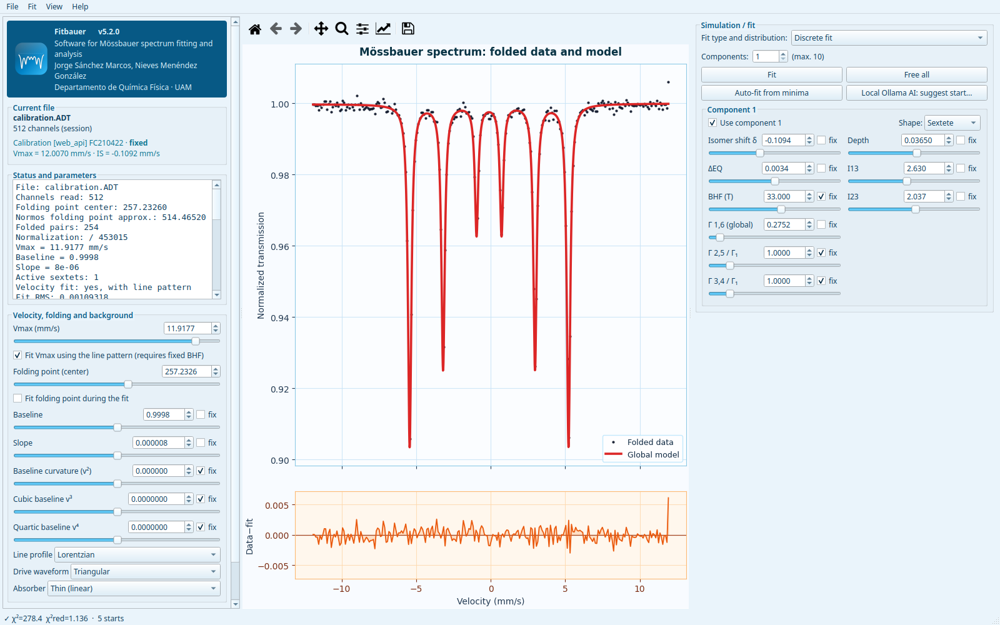
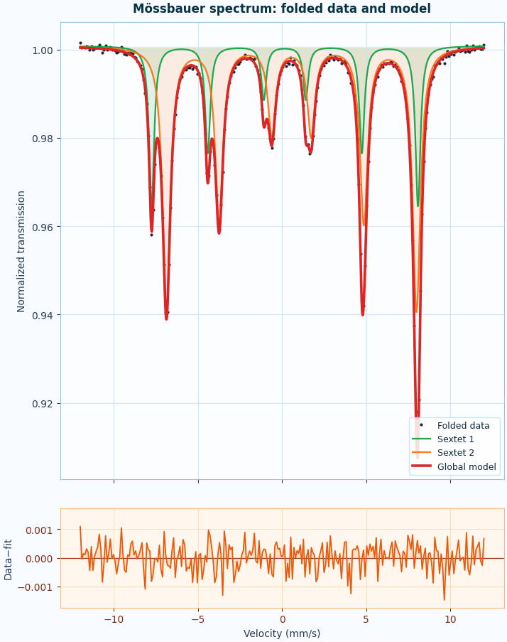
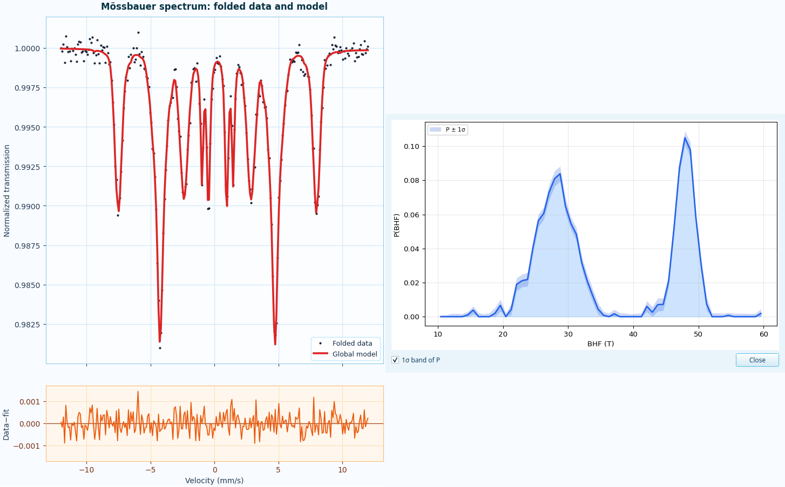
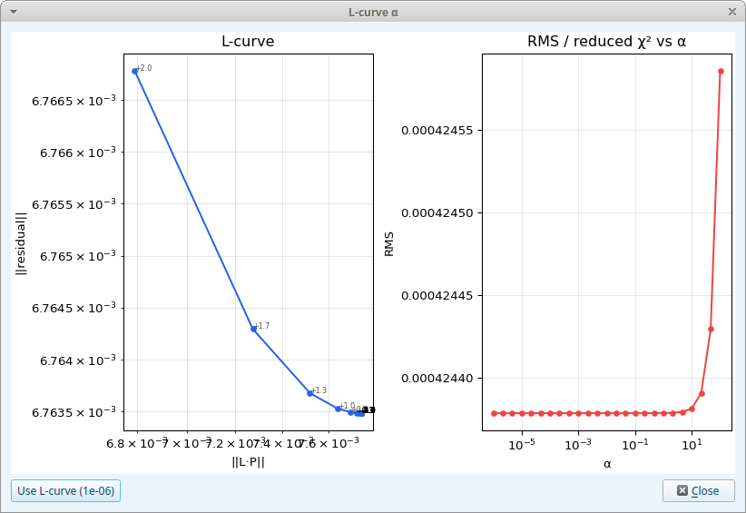
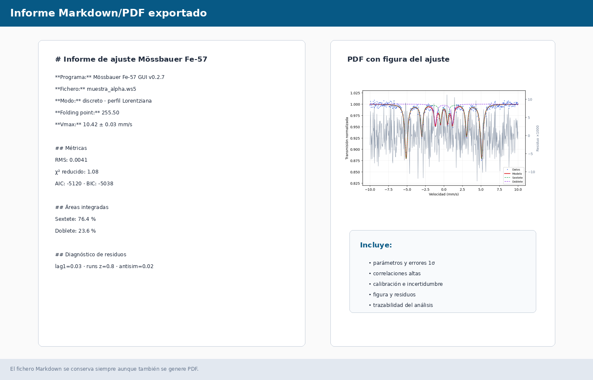

<p align="center">
  
</p>

<h1 align="center">Fitbauer</h1>

<p align="center"><b>Software for Mössbauer spectrum fitting and analysis.</b></p>

<p align="center">
  <a href="README_ES.md">🇪🇸 Versión en español</a>
</p>

<p align="center">
  
  
  
  
</p>

Stable desktop application to load, fold, simulate and fit ⁵⁷Fe Mössbauer spectra.

Current stable version: **v5.2.4**  
Launch: `python fitbauer.py`  
Headless CLI fitting: `mossbauer_fit_cli.py` (discrete) · `fit_bhf_distribution_cli.py` (distributions)

**Authors:** Jorge Sánchez Marcos · Nieves Menéndez González  
Department of Physical Chemistry · UAM

---

## Contents

- [Fitbauer and NORMOS](#fitbauer-and-normos) — why it exists, and how it was validated against the original program
- [Features](#features)
- [Screenshots](#screenshots)
- [Quick start](#quick-start)
- [Fitting modes](#fitting-modes) — discrete, distribution and relaxation
- [Installation](#installation) — requirements, installer script, manual setup, running, updating, troubleshooting
- [Project structure](#project-structure)
- [Changelog](#changelog)
- [License](#license)

---

## Fitbauer and NORMOS

NORMOS (R. A. Brand, 1990-1994) is the program behind a large part of the
published Mössbauer literature. It runs under DOS, it is proprietary and it is
no longer maintained. Fitbauer exists so that this body of work —and those
files— can **keep being used** from a current, open, cross-platform program.

That demands two things: producing the same numbers as NORMOS, and speaking its
file format. Both have been verified against the original program.

### Validated against NORMOS, with numbers

Fitbauer's physics has been checked on two independent benchmarks.

**1. Synthetic benchmark.** NORMOS generates a spectrum from known parameters,
Fitbauer fits it, and the result is compared with the truth.

| | spectra | fits | comparisons |
|---|---|---|---|
| Round-trip NORMOS → Fitbauer | 411 | ~1,150 | 6,497 |

Median deviation from the true value:

| Block | position | BHF | linewidth |
|---|---|---|---|
| First-order sextet/doublet | 2·10⁻⁷ mm/s | 6·10⁻⁶ T | 8·10⁻⁷ mm/s |
| Full Hamiltonian | 6·10⁻⁵ mm/s | 1.4·10⁻³ T | 5·10⁻⁴ mm/s |
| Texture and intensities | 2·10⁻⁷ mm/s | 6·10⁻⁶ T | 2·10⁻⁵ mm/s |
| Multi-site and constraints (up to 10 sites) | 7·10⁻⁶ mm/s | 1·10⁻⁵ T | 7·10⁻⁵ mm/s |

In the first-order core the agreement is **exact** to numerical precision. The
residual tail in the Hamiltonian case is the approximation made by NORMOS 1994
itself, not by Fitbauer.

**2. Real-job benchmark.** 407 distinct jobs fitted in NORMOS over the years —not
synthetic: laboratory measurements, with their models and their results—
reloaded into Fitbauer and refitted from NORMOS's own solution, on the data
folded exactly as NORMOS folds them (whole channel pairs at ⌊PFP⌋ + 0.5) and
with the same free parameters; recomputed this way, NORMOS's χ² matches the one
in its `.RES` to about 1 %. A comparison
only means something where NORMOS fitted well and both programs see the same
spectrum, so only those jobs are kept:

- NORMOS's reduced χ² ≤ 2: **214 jobs where NORMOS did not fit well are
  discarded**;
- Fitbauer reproduces NORMOS's curve at its solution (to 1 % of the peak), both
  see the same folded data (to 0.3 of the noise) and the `.JOB` still matches
  its `.RES` (19 jobs discarded, mostly with the folding point far from the
  centre, where NORMOS's folding cannot be reproduced);
- 28 jobs cannot be analysed (distribution jobs, missing spectrum or results).

On the remaining **146 jobs**:

- Fitbauer reaches the same or a lower χ² in **146 of 146**; median reduced
  χ²: NORMOS **1.40** · Fitbauer **1.38**.
- Median parameter agreement:

  | δ | ΔEQ | BHF | Γ | depth |
  |---|---|---|---|---|
  | 0.0006 mm/s | 0.0015 mm/s | 0.0034 T | 0.0014 mm/s | 0.0001 |

In units of NORMOS's own errors the differences have a median of 0.15–0.2σ
and no bias; the few above 3σ are jobs where NORMOS had stopped short of the
minimum (Fitbauer's χ² is lower, and NORMOS reaches it when started from
Fitbauer's solution). The figures hardly change with a χ² cut of 1.5 or 3. Among the discarded
jobs, two had NORMOS stopped in a local minimum: from the same starting values
Fitbauer reaches a reduced χ² of about 1.5 instead of 20–30, and NORMOS
confirms it when started there. The jobs are laboratory
data and are not distributed; the synthetic bank and the reports are in
[`validacion/informe/`](validacion/informe/).

### Opens and writes `.JOB` files

**File ▸ NORMOS (.JOB)**

- **Import** rebuilds the model **and loads its spectrum**: a `.JOB` names its
  files in the header, and Fitbauer looks for them next to it. Both
  **NORMOS-SITE** jobs (discrete sites) and **NORMOS-DIST** jobs (distributions)
  work; the latter are detected automatically and open the P(BHF)/P(ΔEQ) panel.
- **Export** writes the current model in NORMOS format. **NORMOS has been
  verified to accept the file Fitbauer produces**, reproducing the original
  theory with a difference of exactly zero.
- The delicate convention conversions —`WID`/`W13` widths versus Γ₁, `D13`/`D23`
  area ratios versus depth ratios, the global numbering of `NDEX` constraints—
  are handled automatically, and the importer **warns about everything it could
  not carry over**.

Fitbauer **does not run NORMOS and does not ship it**: it only speaks its text
format, which is not proprietary.

### What Fitbauer does that NORMOS does not

| | NORMOS | Fitbauer |
|---|---|---|
| **2D distributions** | — | P(BHF,ΔEQ), P(IS,ΔEQ), P(BHF,IS), as a histogram or as bivariate Gaussians (VBF) |
| **Regularizers** | Tikhonov and maximum entropy | plus **total variation** (edge-preserving) |
| **Choosing α** | by hand | L-curve with automatic elbow and click-to-pick |
| **P(IS)** | singlet kernel | singlet, doublet or sextet kernel |
| **Distribution shapes** | histogram, Gaussian, binomial | plus multi-Gaussian VBF (Rancourt–Ping) |
| **Errors** | covariance matrix | plus Monte Carlo bootstrap and asymmetric profile-likelihood intervals |
| **Minimum search** | single start | multi-start and automatic global escalation (differential evolution) |
| **Series of spectra** | one file at a time | **sequential batch fitting** with warm start |
| **Superparamagnetism** | — | Néel–Arrhenius with lognormal size distribution and **global multi-temperature fit** |
| **Voigt profile** | approximate pseudo-Voigt | exact Voigt |
| **Diagnostics** | χ² | plus residual tests (lag-1, runs), correlations (also of P with Γ, δ…) and insufficient-grid warning |
| **Outputs** | text | Markdown/PDF reports, TSV with subspectra and complete JSON session |
| **Headless use** | — | CLI for discrete and distribution fits |
| **Platform** | DOS | Windows, macOS and Linux |
| **Languages** | English | 8 languages, with integrated help |
| **Licence** | proprietary | Apache 2.0, open source |

Several parts of the calculation are also measurably more accurate: Hamiltonian
diagonalisation in double precision (Hermitian LAPACK versus general EISPACK in
`REAL*4`), a source kernel integrated over each channel instead of sampled, and
cubic interpolation when folding instead of truncating to a whole channel.

### What it still does not do

Stated just as plainly. None of this blocks routine ⁵⁷Fe work, but it is worth
knowing:

- **⁵⁷Fe only.** NORMOS also handles ¹¹⁹Sn, ¹⁹⁷Au, ¹⁵¹Eu and ¹²¹Sb.
- **Analytical Czjzek / Le Caër distributions.** The histogram reproduces their
  shape, but there is no 2-3 parameter closed form to fit directly.
- **External field in Ising relaxation** (`BEXT`): population polarization is
  there; the line shift it causes is not.
- **Emission spectra** (source in the sample).
- **Two overlapping distribution blocks**, each with its own grid. Fitbauer
  handles one, plus sharp components.
- **Octet** (ΔmI = ±2): modelled as a sextet plus two singlets, not as a
  component of its own.
- **Preprocessing**: channel rebinning, adding several spectra or rescaling
  counts.
- When importing a distribution `.JOB`, the **`LAMDA` smoothing parameter is not
  carried over**: NORMOS's is absolute and Fitbauer's is dimensionless, so it has
  to be set with the L-curve.

The complete inventory, capability by capability and with the exact NORMOS source
reference, is in
[`validacion/informe/COVERAGE_NORMOS_EN.md`](validacion/informe/COVERAGE_NORMOS_EN.md);
what remains, with what to touch and how to validate it, is in
[`PENDING_NORMOS_EN.md`](validacion/informe/PENDING_NORMOS_EN.md).

---

## Features

- Load local `.ws5` and `.adt` files; download measurements and calibrations from the laboratory web database.
- Spectrum folding with a fractional folding point and cubic interpolation.
- **Discrete fitting** — singlets, doublets and sextets; Lorentzian/Voigt profiles; Poisson or Gaussian likelihood; robust loss functions; χ²/AIC/BIC.
- **Multi-start fitting** with configurable restarts and Monte Carlo bootstrap errors.
- **Profile-likelihood confidence intervals** with adaptive scan.
- **Distribution fitting** — `P(BHF)`, `P(ΔEQ)`, `P(IS)` and three 2D modes (`P(BHF,ΔEQ)`, `P(IS,ΔEQ)`, `P(BHF,IS)`); Hesse-Rübartsch regularization; L-curve α estimation; simultaneous sharp components.
- Advanced quadrupole: first-order, fixed Kündig, powder Kündig; sextet intensity texture.
- Physical constraint presets (3:2:1 powder, tied widths, linked δ/Γ across components).
- Relaxation models: phenomenological, Blume–Tjon two-state, Néel–Arrhenius with lognormal size distribution.
- Parameter limits fully configurable through the GUI (View → Parameter limits…).
- Interactive Matplotlib figure with semi-manual minimum editor.
- Batch fitting across a series of files with warm-start.
- Fit export as TSV with **per-component subspectra** and an informative header.
- Markdown/PDF reports: full report and condensed short report.
- Complete JSON session save/load; persistent settings across restarts.
- Update checking and one-click download from GitHub Releases.
- Interface and integrated help in **English**, Spanish, French, German, Portuguese, Russian, Japanese and Chinese.

---

## Screenshots

> The interface language is English by default.

### Main window



### Discrete fit (doublets)



### Hyperfine-field distribution P(BHF)



### Regularization L-curve



### Short Markdown/PDF report



---

## Quick start

```bash
python3 -m venv .venv
source .venv/bin/activate          # Windows: .venv\Scripts\activate
pip install -r requirements.txt
python fitbauer.py
```

Try the included sample data:

1. **File → Open…** → `data_sample/magnetita_Fe3O4.adt`
2. **File → Load session…** → `data_sample/Fe3O4_session.json`

Typical workflow:

```
Open spectrum → check folding/Vmax → choose model → fit
  → inspect residuals/areas → export session/report
```

---

## Fitting modes

### Discrete fit

Up to ten simultaneous components (singlet / doublet / sextet, plus the relaxation types below). Each component has its own type, parameters and fixed/free status. The **Fit** button optimises all free parameters; the status panel reports integrated areas, covariance or bootstrap (Monte Carlo) errors, and fit statistics.

For sextets the main parameters are:

| Parameter | Meaning |
|-----------|---------|
| δ (IS) | Isomer shift (mm/s) |
| ΔEQ | First-order quadrupole splitting (mm/s) |
| BHF | Hyperfine field (T) |
| Γ 1,6 | FWHM of the outer lines (mm/s) |
| Γ 2,5 rel / Γ 3,4 rel | Relative widths of lines 2,5 and 3,4 |
| Depth | Global absorption amplitude |
| int1 / int2 | Relative intensities (≈ D13, D23); int3 fixed to 1 |

### Distributions: P(BHF), P(ΔEQ), P(IS) and 2D

Models the spectrum as a sum of many sextets (or doublets) on a regular grid. The Hesse-Rübartsch-style optimisation minimises:

```
weighted spectral residual² + α · roughness(P)²
```

Use **L-curve α** to find a good compromise between residual and smoothness. Besides the histogram there are parametric shapes (Gaussian, VBF multi-Gaussian, NORMOS-style binomial, fixed and, for P(ΔEQ) of glasses and amorphous materials, pure or extended Czjzek); in the Gaussian shapes the width σ can be bounded with **σ min / σ max**. The **Add active sharp components** option mixes the distribution with discrete phases (e.g. a broad distribution + metallic Fe at BHF ≈ 33 T). Two-dimensional modes fit P(BHF, ΔEQ), P(IS, ΔEQ) and P(BHF, IS), as a regularized histogram or as bivariate Gaussians. The distribution plot shows a Monte Carlo 1σ band for the histogram and, when δ or ΔEQ are correlated with the grid variable (κ slopes), the δ(x)/ΔEQ(x) line with its uncertainty; each overlay can be switched off.

### Relaxation models

| Type | Description |
|------|-------------|
| Relajacion | Phenomenological blocked/superparamagnetic interpolation |
| BlumeTjon | Dynamic two-state ±BHF exchange |
| NeelSize | Néel–Arrhenius + lognormal size distribution (also as a global multi-temperature fit) |

---

## Installation

Fitbauer is a Python application — there is **no compiled `.exe`**. You run it with
Python, either through the bundled installer script (recommended) or by setting up
the environment by hand. The one-liner is in [Quick start](#quick-start); this
section covers every case. The standalone reference is [`INSTALL_EN.md`](INSTALL_EN.md).

### 1. Requirements

| | |
|---|---|
| **Python** | 3.11 or newer (CI runs on 3.12). On Windows, tick **“Add Python to PATH”** in the installer. |
| **pip** | Ships with Python; the installer upgrades it inside the virtual environment. |
| **OS** | Windows 10/11, macOS 12+, or Linux (X11 or Wayland). |
| **Internet** | Needed once to download the Python dependencies, and for *Help ▸ Check for updates*. |
| **Disk** | ~400 MB for the virtual environment (mostly PySide6/Qt). |

Runtime dependencies, installed automatically: `numpy >= 2.0`, `scipy`,
`matplotlib`, `requests`, `PySide6 >= 6.5`.

### 2. Get the code

Clone the repository:

```bash
git clone https://github.com/sullymike/Fitbauer.git
cd Fitbauer
```

…or download a release ZIP from the
[Releases page](https://github.com/sullymike/Fitbauer/releases), unzip it, and open
a terminal in the resulting folder. **The release ZIP is the source, not a
binary** — you still run one of the installs below.

### 3. Install — option A: installer script (recommended)

From the project folder:

**Linux / macOS**

```bash
python3 install.py
./fitbauer
```

**Windows**

```bat
py install.py
fitbauer.bat
```

If `py` is not recognised, use `python install.py`.

`install.py` does everything in one step:

- creates a local virtual environment in `.venv/`;
- installs the dependencies from `requirements.txt`;
- writes the launchers `fitbauer` (Linux/macOS) and `fitbauer.bat` (Windows);
- runs a quick byte-compile smoke test;
- **registers Fitbauer in the system application menu** (per-user, no admin
  rights) so it opens from the menu with its icon:
  - Linux — `~/.local/share/applications/fitbauer.desktop` (*Education* category);
  - Windows — a *Fitbauer* folder in the Start Menu;
  - macOS — menu registration is skipped; launch with `./fitbauer`.

Installer flags:

```bash
python install.py               # full install + menu registration
python install.py --menu-only   # only (re)register the menu entry
python install.py --no-menu     # install, leave the menus untouched
python install.py --uninstall   # remove the menu entry
```

### 4. Install — option B: manual virtual environment

If you would rather manage the environment yourself:

```bash
python3 -m venv .venv
source .venv/bin/activate            # Windows: .venv\Scripts\activate
pip install --upgrade pip
pip install -r requirements.txt
python fitbauer.py
```

For the test suite, also install the dev requirements:

```bash
pip install -r requirements-dev.txt
QT_QPA_PLATFORM=offscreen pytest -q   # add "xvfb-run -a" on headless Linux
```

### 5. Run it

- **Installer route:** `./fitbauer` (Linux/macOS) or `fitbauer.bat` (Windows), or
  the application-menu entry.
- **Manual route:** activate `.venv` and run `python fitbauer.py`.
- **Headless fitting, no GUI:** `python mossbauer_fit_cli.py` (discrete) or
  `python fit_bhf_distribution_cli.py` (distributions).

First run, with the bundled sample data:

1. **File ▸ Open…** → `data_sample/magnetita_Fe3O4.adt`
2. **File ▸ Load session…** → `data_sample/Fe3O4_session.json`

### 6. Update

- **From inside the app:** *Help ▸ Check for updates…* downloads the latest release
  ZIP. A stable/beta channel can be chosen in the update settings.
- **From source:** `git pull`, then re-run `python install.py` — it reuses `.venv`
  and refreshes the dependencies. With a release ZIP, unzip the new one over the
  folder and re-run `python install.py`.

### 7. Build a standalone executable (optional)

```bash
pip install pyinstaller
pyinstaller Fitbauer.spec        # → dist/Fitbauer/
```

The folder `dist/Fitbauer/` then runs without any Python installation.

### 8. Troubleshooting

| Symptom | Fix |
|---|---|
| `python3: command not found` | Install Python 3 from [python.org](https://www.python.org/downloads/) or your distro's package manager. |
| GUI does not start | Check the venv is active, then `pip install -r requirements.txt` and `python -m py_compile fitbauer.py mossbauer_qt.py`. |
| `ImportError` for PySide6, or a Qt *"platform plugin"* error on Linux | Install the system libraries Qt needs — on Debian/Ubuntu: `libgl1`, `libxkbcommon-x11-0`, `libegl1`. On a headless machine set `QT_QPA_PLATFORM=offscreen`. |
| PDF report fails | The Markdown report is still written; PDF export needs optional rendering libraries on some systems. |
| Menu entry not created | Re-run `python install.py --menu-only` (on macOS this step is intentionally skipped). |

---

## Project structure

```
core/          Physics and fitting engine (no GUI dependency)
gui/           Modular Qt/Matplotlib GUI — thin controllers only
locales/       Translations: en / es / fr / de / pt / ru / ja / ch
data_sample/   Sample spectra and sessions
tests/         Physics, fitting, CLI and Qt tests
```

The physics and fitting engines live exclusively in `core/`; the GUI is a thin client. See [`docs/architecture.md`](docs/architecture.md) for details.

---

## Changelog

See [`CHANGELOG.md`](CHANGELOG.md).

---

## License

Fitbauer is released under the **Apache License 2.0** — see [`LICENSE`](LICENSE) and
[`NOTICE`](NOTICE).

This program uses the **Qt** toolkit through the **PySide6** bindings, under the terms of
the **GNU Lesser General Public License v3 (LGPLv3)**. Qt is not modified; the full licence
text ships in [`licenses/LGPL-3.0.txt`](licenses/LGPL-3.0.txt) and
[`licenses/GPL-3.0.txt`](licenses/GPL-3.0.txt). In the binary builds, the Qt libraries are
bundled as ordinary shared libraries and can be replaced by a compatible build, as LGPLv3 §4
provides.

Every third-party component and its licence is listed in
[`THIRD-PARTY-LICENSES.md`](THIRD-PARTY-LICENSES.md).

© Jorge Sánchez Marcos, Nieves Menéndez González — Department of Physical Chemistry, UAM.
